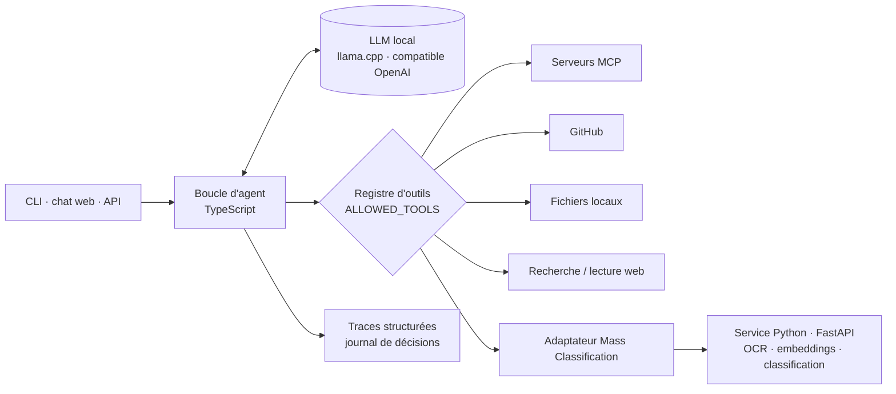

# Harness — moteur d'agents LLM locaux + plateforme de classification documentaire

**Un moteur TypeScript qui transforme un LLM local en agent contrôlé et observable — et un monorepo qui le relie à un service Python de classification documentaire.** Permissions d'outils explicites, connecteurs MCP, traces structurées et banc d'évaluation reproductible, le tout exécutable sur du matériel grand public via `llama.cpp`.

[](https://github.com/Matt95354855/Harness/actions/workflows/ci.yml) [](https://github.com/Matt95354855/Harness/actions/workflows/mass-e2e.yml)     

[English](README.md) · [Français](README.fr.md)

## Résultats

**Classification de mise en page DocLayNet, entièrement en local** (20 pages de test, 203 objets, texte + géométrie, Windows 11, RTX 2000 Ada 4 Go) :

| Modèle | Format | Accuracy | Macro-F1 |
|---|---|---:|---:|
| **GPT-OSS 20B** | GGUF MXFP4 | **82,76 %** | **66,85 %** |
| Qwen 3.6 27B Instruct | GGUF Q4_K_M | 78,82 % | 56,48 % |

Protocole complet, F1 par classe et limites : [rapport de benchmark](docs/doclaynet-benchmark-2026-10-01.md).

**Contrôles qualité** : 98 tests TypeScript + 56 tests Python ciblés ; une exécution de bout en bout réelle en CI (PostgreSQL/pgvector, Redis, worker, OCR Tesseract, embeddings réels) sur des PDF/DOCX synthétiques avec texte, images et tableaux.


<sub>Chaque exécution produit une trace structurée : requêtes au modèle, consommation de tokens, décisions (`nextAction`, `toolName`, paramètres), résultats d'outils.</sub>

## Points forts

- **Boucle d'agent contrôlée** : décider → appeler un outil autorisé → observer → répondre, avec budgets d'itérations, de temps et de taille ; une décision mal formée échoue explicitement au lieu d'être devinée.
- **Connecteurs désactivés par défaut** : MCP (Streamable HTTP et `stdio`), GitHub (MCP en lecture seule), dossiers locaux autorisés, Google Drive (OAuth en lecture), recherche et lecture web avec validation des URL. `ALLOWED_TOOLS` limite ce qui est chargé.
- **Contenus externes non fiables** : permissions, délais, tailles maximales et listes d'autorisation s'appliquent avant que quoi que ce soit n'atteigne le modèle.
- **Chaîne de classification documentaire** : contrat de résultat versionné, routage PDF/DOCX déterministe (OCR avant extraction native), fusion conservatrice avec détection des désaccords et revue humaine, rapports reproductibles de précision / rappel / F1 / abstention.
- **Fonctionne sans clé API** : un modèle simulé déterministe et des fixtures font tourner la démo et les tests hors ligne.

## Architecture



## Démarrage rapide

```bash
git clone https://github.com/Matt95354855/Harness.git
cd Harness
npm ci
npm run demo            # exécution complète avec le modèle simulé, sans clé API
npm run check           # lint, typage, tests
npm run dev -- chat     # conversation avec votre modèle local configuré
```

Configuration d'un modèle local (`llama.cpp`, Qwen, GPT-OSS) et parcours PDF/DOCX : [guide du modèle local](docs/local-model.md) · [parcours documentaire](docs/document-workflow.md).

## Structure du dépôt

```text
src/core/        configuration, contrats, orchestration de l'agent
src/models/      client LLM, modèle simulé, adaptateurs
src/hermes/      décision et réflexion structurées
src/tools/       client MCP, GitHub, Drive, web, fichiers, registre, exécuteur
src/memory/      conversation, journal de décisions, validation
src/web/         serveur de chat web local
services/mass-classification/   service documentaire Python (FastAPI, worker, modèles)
tests/           tests unitaires et d'intégration
scripts/         benchmark DocLayNet et outillage d'évaluation
docs/            architecture, API, connexions, benchmarks, rapports de validation
```

## État

Implémenté : monorepo unifié, contrat de résultat v1, route de capacités, adaptateur, profilage des documents, routage déterministe, garde-fous de fusion, outillage d'évaluation. Suite : routage adapté à la qualité et abstention calibrée ; un corpus métier annoté est nécessaire pour mesurer la précision métier. Voir [l'état d'implémentation](docs/implementation-status.md).

## Documentation

[Guide détaillé](docs/GUIDE.fr.md) · [Architecture](docs/architecture.md) · [API](docs/api.md) · [Connexions](docs/connections.md) · [Outils](docs/tools.md) · [Plateforme unifiée](docs/unified-platform.md) · [Validation](docs/validation.md)

## Licence

MIT — voir [LICENSE](LICENSE).
