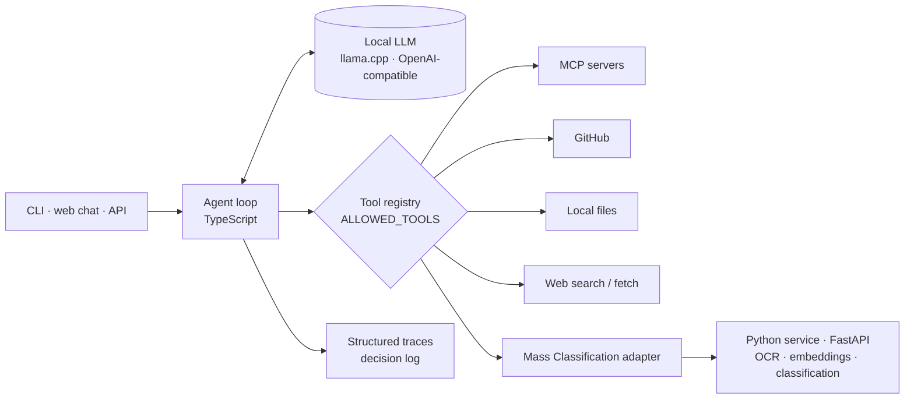

# LLM Agent Harness — local LLM agent runtime + document classification platform

**A TypeScript runtime that turns a local LLM into a controlled, observable agent — and a monorepo that wires it to a Python document-classification service.** Explicit tool permissions, MCP connectors, structured traces and a reproducible evaluation bench, all runnable on consumer hardware through `llama.cpp`.

[](https://github.com/Matt95354855/llm-agent-harness/actions/workflows/ci.yml) [](https://github.com/Matt95354855/llm-agent-harness/actions/workflows/mass-e2e.yml)     

[English](README.md) · [Français](README.fr.md)

## Results

**DocLayNet layout classification, fully local** (20 test pages, 203 objects, text + geometry, Windows 11, 4 GB RTX 2000 Ada):

| Model | Format | Accuracy | Macro-F1 |
|---|---|---:|---:|
| **GPT-OSS 20B** | GGUF MXFP4 | **82.76 %** | **66.85 %** |
| Qwen 3.6 27B Instruct | GGUF Q4_K_M | 78.82 % | 56.48 % |

Full protocol, per-class results and limits: [benchmark report](docs/doclaynet-benchmark-2026-10-01.md).

**Quality gates**: 98 TypeScript tests + 56 targeted Python tests; a real end-to-end CI run (PostgreSQL/pgvector, Redis, worker, Tesseract OCR, real embeddings) on synthetic PDF/DOCX with text, images and tables.


<sub>Every run produces a structured trace: model requests, token usage, decisions (`nextAction`, `toolName`, parameters), tool results.</sub>

## Highlights

- **Controlled agent loop**: decide → call an allowed tool → observe → answer, with iteration, time and size budgets; malformed model decisions fail explicitly instead of being guessed.
- **Connectors, off by default**: MCP (Streamable HTTP and `stdio`), GitHub (read-only MCP), allowed local folders, Google Drive (read-only OAuth), web search and fetch with URL validation. `ALLOWED_TOOLS` restricts what loads.
- **External content is untrusted**: permissions, timeouts, size caps and allow-lists apply before anything reaches the model.
- **Document classification pipeline**: versioned result contract, deterministic PDF/DOCX routing (OCR before native extraction), conservative fusion with disagreement detection and human review, reproducible precision / recall / F1 / abstention reports.
- **Runs without any API key**: a deterministic mock model and fixtures make the demo and the test suite work offline.

## Architecture



## Quick start

```bash
git clone https://github.com/Matt95354855/llm-agent-harness.git
cd llm-agent-harness
npm ci
npm run demo            # end-to-end run with the mock model, no API key
npm run check           # lint, typecheck, tests
npm run dev -- chat     # chat with your configured local model
```

Local model setup (`llama.cpp`, Qwen, GPT-OSS) and the PDF/DOCX workflow: [local model guide](docs/local-model.md) · [document workflow](docs/document-workflow.md).

## Repository structure

```text
src/core/        configuration, contracts, agent orchestration
src/models/      LLM client, mock model, adapters
src/hermes/      structured decision and reflection
src/tools/       MCP client, GitHub, Drive, web, files, registry, executor
src/memory/      conversation, decision log, validation
src/web/         local web chat server
services/mass-classification/   Python document service (FastAPI, worker, models)
tests/           unit and integration tests
scripts/         DocLayNet benchmark and evaluation tooling
docs/            architecture, API, connections, benchmarks, validation reports
```

## Status

Implemented: unified monorepo, result contract v1, capabilities route, adapter, document profiling, deterministic routing, fusion guards, evaluation tooling. Next: quality-adaptive routing and calibrated abstention; a business-labelled corpus is required to measure domain accuracy. See [implementation status](docs/implementation-status.md).

## Documentation

[Detailed guide (FR)](docs/GUIDE.fr.md) · [Architecture](docs/architecture.md) · [API](docs/api.md) · [Connections](docs/connections.md) · [Tools](docs/tools.md) · [Unified platform](docs/unified-platform.md) · [Validation](docs/validation.md)

## License

MIT — see [LICENSE](LICENSE).
